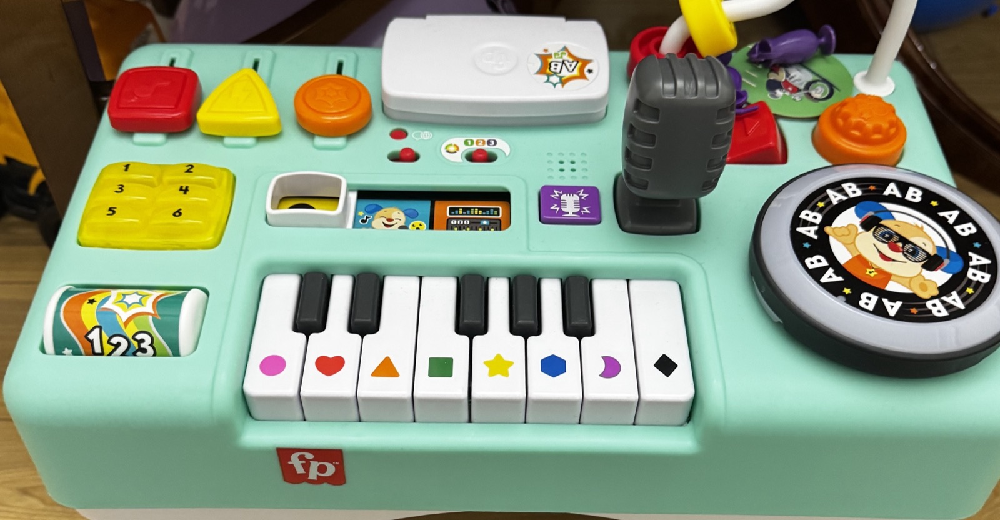

# Toy Piano Play-Along

Turn a song into colored shapes you can play on a baby's toy piano while the song plays. It is built for old Turkish songs that have no sheet music online.



Made for the one-octave keyboard on the Fisher-Price baby activity center in the photo: 8 white keys (pink circle, red heart, orange triangle, green square, yellow star, blue hexagon, purple moon, black diamond) and 5 unmarked black keys. Any one-octave C-to-C toy works the same way.

**Open it:** https://mertnesvat.com/toy-piano-playalong/ (Chrome on a computer; nothing to install).

## How to use it

1. **Add a song.** On the start page press **Add a song**.
2. **Song.** Type the title and artist. If you have an `open.spotify.com/track/…` link, paste it and press **Get title**. Spotify only shares the title this way, so type the artist yourself.
3. **Audio**, one of:
   - **Upload a file** (mp3, wav, m4a, ogg, webm, or a video file).
   - **Record microphone**: play the song from a speaker or phone near the computer, press **Stop** at the end.
   - **Capture a Chrome tab**: start the song in another tab, press the button, choose that tab and keep **Also share tab audio** on. Press **Stop** at the end. If the meter stays flat (some players, possibly Spotify's logged-in web player, may block capture), the app says so: use the microphone instead.
4. **Melody.** Press **Find the melody**.
   - *Full song with instruments* (default) uses Spotify's Basic Pitch model and then keeps the single most salient line, which follows the voice in most recordings.
   - *Just one voice* is a fast pitch tracker for humming or a solo singer.
5. **Lyrics** (optional).
   - **Find synced lyrics (LRCLIB)** looks the song up by title and artist.
   - **Transcribe with Whisper** listens to the song on your computer (Turkish, word timings). The first run downloads the model (*small* is roughly 250–600 MB depending on the graphics card, *base* much less) and the browser keeps it afterwards. With a graphics card that supports WebGPU, transcribing a 3-minute song takes seconds; without one it runs on one CPU core and takes several minutes. Old recordings come out with many mistakes, so expect to fix the text.
   - You can always paste or fix the words in the box. One line per row; `[mm:ss.xx]` at the start of a line sets when it is sung, and lines without a time are spread out between the timed ones.
6. **Fit it to the toy.** The box explains in plain words what happened to the notes. Options:
   - **White keys only (baby mode)**: black-key notes move to the nearest white key.
   - **Shift the key to fit the toy better**: fewer jumps across the keyboard, but the toy will no longer be in tune with the recording.
7. **Save and play.** Shapes fall toward the toy's keys; press the key when a shape reaches it. The words show underneath, with the current word highlighted.
   - **Speed** slows the song down without changing its pitch.
   - Drag the position bar to start from any point; **−5 s** or the left arrow goes back 5 seconds; space plays and pauses.
8. Your songs are listed on the start page. They are stored only in this browser (IndexedDB).

### What happens to the notes

- Every note is rounded to the nearest semitone, so makam microtones are dropped. The app first measures how far the whole recording is from concert pitch (old 78rpm transfers often run a little sharp or flat) and rounds relative to that.
- By default every note keeps its note name, so pressing the key sounds in tune with the song *if* the toy is tuned to concert pitch (not yet checked).
- The toy has only one octave, so the tune is folded into it. The app picks, for each C and each folded step, the key that keeps the toy's moves closest to the song's real steps, which puts the unavoidable jumps where they hurt least.

### Privacy

Audio and lyrics never leave your computer. The only network requests are: the page itself, the Basic Pitch and Whisper model files, the song title and artist to LRCLIB, and a Spotify link to Spotify's oEmbed endpoint. There is no server, account or key.

## Development

```sh
npm install
npm run dev      # http://localhost:5173
npm test         # unit tests (note mapping, melody post-processing, pitch tracker, lyrics)
npm run build    # static site in dist/
```

`scripts/make-test-melody.ts` writes a generated test song with known notes (`node --experimental-strip-types scripts/make-test-melody.ts out.wav [detuneCents]`). Never commit copyrighted audio or lyrics, test fixtures included.

Pushing to `main` deploys `dist/` to GitHub Pages (`.github/workflows/pages.yml`). Pull requests run the tests (`.github/workflows/ci.yml`).
